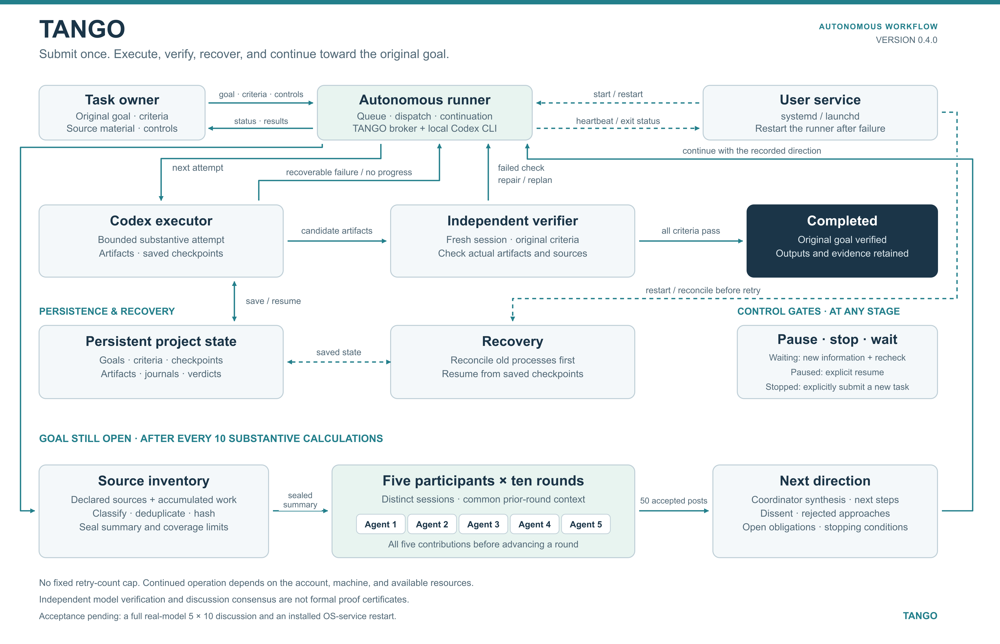

# TANGO 0.4.0 Autonomous Source

TANGO runs a task through repeated execution, independent verification, and checkpoint recovery using a locally installed, authenticated Codex CLI. Submit the original goal once; the runner continues making attempts until the goal is verified, you pause or stop it, or a real prerequisite needs attention.

There is no fixed retry-count limit. Continued operation still depends on the computer, account capacity, available permissions, and the configured user service. It does not promise unlimited compute or that every task can be solved.

**A real five-agent, ten-round discussion has not yet passed end-to-end acceptance.** See [TEST_REPORT.md](TEST_REPORT.md) for exactly which local and real-service checks have been performed.

Start with [GETTING_STARTED.md](GETTING_STARTED.md) or the detailed [autonomous runner guide](docs/AUTONOMOUS.md).

## Autonomous workflow



[View the vector diagram](assets/tango-autonomous-workflow.svg).

## What this version adds

- A local Codex CLI execution backend with actual session IDs, structured results, and recorded process outcomes.
- A persistent runner that executes queued work, retries recoverable failures, and preserves checkpoints between attempts.
- Separate execution and verification sessions. Only verification against the original criteria can complete a task.
- Recovery of registered attempts after interruption, with ambiguous worker state held for inspection rather than duplicated.
- Explicit systemd user-service and macOS LaunchAgent installation for background execution and restart after failure.
- Five distinct discussion participants, synchronized across ten rounds, after each ten substantive calculations. Each meeting starts from a sealed source inventory and produces a direction for the next attempt.

The original collaboration adapter does not wake the native parent on its own. It remains available as a separate integration mode through the [native parent procedure](docs/NATIVE_PARENT_LOOP.md) and [native-adapter usage guide](docs/USAGE.md). The new local CLI backend records its own execution provenance; it does not label CLI runs as collaboration tool calls.

## Requirements

- Python 3.10 or later on Linux or macOS, with the standard library's SQLite and POSIX locking support.
- An installed Codex CLI supporting noninteractive execution, JSON events, structured output, and session resume.
- A working Codex CLI login and model access. A CLI already signed in through ChatGPT can use that account; TANGO does not require a separate API key for that sign-in method. Existing CLI model configuration is used.
- Network and account capacity for actual model execution. The five-participant meeting also requires capacity for concurrent worker sessions.

The installer itself uses the Python standard library and works without downloading Python packages. Actual model execution is provided by Codex CLI. The old queue-only service still depends on Linux `/proc`; the new autonomous runner has separate Linux and macOS service support.

## Install and submit one task

From the repository root, use Python 3.10 or later and choose a fresh installation home. Replace the example absolute paths with your own:

```sh
python3 -B installer/package.py --verify
sh install.sh --check --home /absolute/path/to/tango-home
sh install.sh --apply --home /absolute/path/to/tango-home
/absolute/path/to/tango-home/bin/tango-auto --codex /absolute/path/to/codex doctor
```

To run a task in the current terminal:

```sh
/absolute/path/to/tango-home/bin/tango-auto --codex /absolute/path/to/codex submit \
  --goal "Write a report comparing the supplied approaches" \
  --criterion "The report addresses each approach and cites the supplied evidence" \
  --source /absolute/path/to/reference-materials
```

For unattended operation, first explicitly install the user service, then submit a task to its queue:

```sh
/absolute/path/to/tango-home/bin/tango-supervisor --codex /absolute/path/to/codex install
/absolute/path/to/tango-home/bin/tango-auto submit \
  --goal-file /absolute/path/to/task.txt --enqueue-only
/absolute/path/to/tango-home/bin/tango-auto status
```

`--enqueue-only` saves work; an active runner or service must pick it up. The service command is an explicit machine configuration step. Preparing or extracting this source package does not activate a service.

See the [autonomous guide](docs/AUTONOMOUS.md) for pause, resume, stop, prerequisites, timeout settings, service inspection, and recovery. Review [installation and migration](docs/INSTALLATION.md) before upgrading an existing home.

## Repository contents

- [`program/`](program/): broker, local CLI backend, autonomous runner, service manager, and retained queue-only service.
- [`installer/`](installer/): offline source installation, integrity checks, and migration rehearsal.
- [`docs/`](docs/): autonomous operation, native-adapter integration, inventory, installation, and release notes.
- [`tests/`](tests/): retained regression tests and new autonomous-execution tests.
- [`baseline/`](baseline/): historical migration fixtures.
- [`spec/user_spec.txt`](spec/user_spec.txt): the original native-adapter public contract.
- [`TEST_REPORT.md`](TEST_REPORT.md): current verification evidence and limitations.

Documentation and broker-generated notices are in English. Existing Chinese input aliases and multilingual regression cases remain for compatibility. Runtime homes contain private task data and belong outside the source repository.

## Integrity and verification

`MANIFEST.sha256` covers the installation payload. `RELEASE_SHA256SUMS` covers the distributed source files except itself. Hashes detect changes; they are not publisher signatures. The [contribution guide](CONTRIBUTING.md) explains validation and checksum updates.

Simulation tests establish behavior under their tested conditions. They do not establish unlimited runtime, full real-model meeting acceptance, or successful deployment on another computer. A service registration and a successful login diagnostic are also distinct from completion of a real task.

See the [GitHub upload guide](docs/GITHUB.md) to publish the source files.

## License

The supplied source archive did not include a license. This distribution does not assign one; the rights holder should choose and add a license before presenting the project as open source.

## Project epigraph

“The great Tang scholar Wu Wenzhong once said: ‘Mathematical proof is essentially coding.’”
